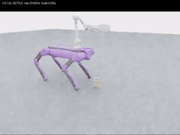

# ATEC_B：Mink全身协调抓取

B2原地下蹲，Z1接近、夹持，再起身配合抬臂。Mink协调机身、四条腿和机械臂；Isaac运行物理，MuJoCo只做运动学。

## 成功抓取 Demo

芥末瓶、糖盒、香蕉各选一个 **0°成功试验**。首页动图展示完整过程，按 **2倍速**播放；点击动图或下方链接查看原速完整 MP4。香蕉使用修复后的成功录像。

| 芥末瓶 | 糖盒 | 香蕉（修复后） |
| :---: | :---: | :---: |
| [](results/mink_multiclass_9/mustard_yaw_p00.mp4) | [](results/mink_multiclass_9/sugar_yaw_p00.mp4) | [](results/mink_banana_repair/verified/banana_yaw_p00/trial_01/continuous.mp4) |
| [完整视频](results/mink_multiclass_9/mustard_yaw_p00.mp4) | [完整视频](results/mink_multiclass_9/sugar_yaw_p00.mp4) | [完整视频](results/mink_banana_repair/verified/banana_yaw_p00/trial_01/continuous.mp4) |
| 抬升 **14.82 cm** · 连续有效夹持 **5.90 s** | 抬升 **14.63 cm** · 连续有效夹持 **5.84 s** | 抬升 **14.73 cm** · 连续有效夹持 **5.86 s** |

以上是三个单次试验的实测指标。芥末瓶、糖盒来自原九次测试；香蕉来自后续修复验证，不能将两批记录合称为一次新的九次测试。[录像来源与校验值](docs/demos/manifest.json)。

## 实测结果

- 芥末瓶、糖盒：此前各三个朝向均成功。
- 平放香蕉修复后：-45°、0°、+45°各一次，**3/3成功**，抬升约14.6–14.8cm，连续有效夹持约5.8–5.9s。
- 物体初始距离固定0.55m。芥末瓶、糖盒下蹲机身高度约42cm；香蕉约30cm、前俯5.7°，四脚支撑。走近目标由后续导航负责。

[香蕉录像、数据和报告](results/mink_banana_repair/report.md)。原九次仍为6/9，保留在 [原九次报告](results/mink_multiclass_9/nine_report.md)。修复失败记录也全部保留，0°成功后未重跑。

成功必须实际抬升≥10cm、最低点离地≥2cm、双指真实夹持并连续保持≥3s。IK可达和程序结束不代替抓取成功。

## 怎么用

原服务器环境已配置，在项目根目录直接运行，每次使用新的输出目录。

只抓一次香蕉（0°）：

```bash
bash scripts/grasp_banana.sh --output runs/banana_once
```

香蕉三个朝向各一次：

```bash
bash scripts/grasp_banana_angles.sh --output runs/banana_three
```

三个物体各三个朝向、每个一次，共九次，不自动重试：

```bash
bash scripts/grasp_all_objects.sh --output runs/objects_nine
```

输出summary.json、trials.csv，各轮trial_01/continuous.mp4，以及分开的controller.jsonl、evaluation.jsonl。单次入口直接在对应输出目录生成trial_01和summary.json。

## 新服务器安装

需要Linux GPU、Isaac Sim 5.1、Isaac Lab 2.3.2、Python 3.11；已验证RTX4090、CPU PhysX/GPU渲染。

```bash
git clone https://github.com/luyuqi-tim/ATEC_B.git
cd ATEC_B
git switch branch-Mink_IK1
source experiments/mink_wholebody/runtime.sh
/isaac-sim/python.sh -m pip install -e . --no-deps
/isaac-sim/python.sh -m pip install -c experiments/mink_wholebody/constraints.txt -r requirements-mink.txt
```

当前镜像路径/isaac-sim和/workspace/isaaclab；换镜像调整runtime.sh、supervise.py。仓库包含原资产与老师权重，不含Isaac安装包。requirements.lock.txt是完整环境快照。

## 从哪里改

- experiments/mink_banana/config.json：成功参数；configs/banana_yaw_*.json和centered_offset_13.json：三朝向配置。
- experiments/mink_banana/controller.py、ik_adapter.py：实际夹爪角度与双指中心协调。
- experiments/mink_wholebody/wholebody_ik.py、controller.py：全身IK、支撑补偿、状态机。
- experiments/mink_multiclass/configs/：原瓶、糖及历史香蕉配置。

这里只验证已知目标位姿抓取；Task B视觉、导航和投放尚未完成。见 [原始README](docs/TaskB_original_README.md)、[第三方声明](THIRD_PARTY_NOTICES.md)。
