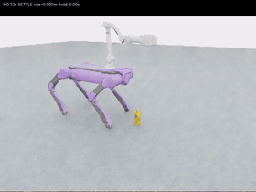
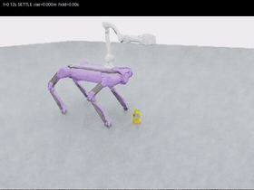
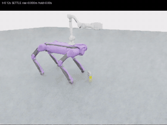
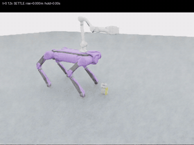
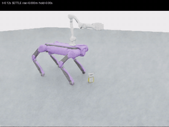
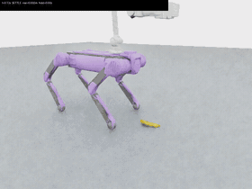

# ATEC_B：Mink全身协调抓取

B2原地下蹲，Z1接近、夹持，再起身配合抬臂。Mink协调机身、四条腿和机械臂；Isaac运行物理，MuJoCo只做运动学。

## 成功抓取 Demo（3 × 3）

2026-10-26 重新执行芥末瓶、糖盒、香蕉各三个角度（−45°、0°、+45°），**九次全部成功，9/9**。每个组合只执行一次，没有自动重试。以下九段均来自这次新测试。

首页展示完整过程的 **2 倍速动态预览**；点击动图或“完整视频”查看原速 MP4。

| 物体 | −45° | 0° | +45° |
| :---: | :---: | :---: | :---: |
| 芥末瓶 | [](results/mink_verify_9_20261026/mustard_yaw_m45/trial_01/continuous.mp4)<br>[完整视频](results/mink_verify_9_20261026/mustard_yaw_m45/trial_01/continuous.mp4)<br>抬升 14.78 cm · 夹持 5.90 s | [](results/mink_verify_9_20261026/mustard_yaw_p00/trial_01/continuous.mp4)<br>[完整视频](results/mink_verify_9_20261026/mustard_yaw_p00/trial_01/continuous.mp4)<br>抬升 14.82 cm · 夹持 5.90 s | [](results/mink_verify_9_20261026/mustard_yaw_p45/trial_01/continuous.mp4)<br>[完整视频](results/mink_verify_9_20261026/mustard_yaw_p45/trial_01/continuous.mp4)<br>抬升 14.79 cm · 夹持 5.90 s |
| 糖盒 | [](results/mink_verify_9_20261026/sugar_yaw_m45/trial_01/continuous.mp4)<br>[完整视频](results/mink_verify_9_20261026/sugar_yaw_m45/trial_01/continuous.mp4)<br>抬升 14.62 cm · 夹持 5.82 s | [](results/mink_verify_9_20261026/sugar_yaw_p00/trial_01/continuous.mp4)<br>[完整视频](results/mink_verify_9_20261026/sugar_yaw_p00/trial_01/continuous.mp4)<br>抬升 14.63 cm · 夹持 5.84 s | [](results/mink_verify_9_20261026/sugar_yaw_p45/trial_01/continuous.mp4)<br>[完整视频](results/mink_verify_9_20261026/sugar_yaw_p45/trial_01/continuous.mp4)<br>抬升 14.64 cm · 夹持 5.84 s |
| 香蕉（修复后） | [](results/mink_verify_9_20261026/banana_yaw_m45/trial_01/continuous.mp4)<br>[完整视频](results/mink_verify_9_20261026/banana_yaw_m45/trial_01/continuous.mp4)<br>抬升 14.66 cm · 夹持 5.84 s | [](results/mink_verify_9_20261026/banana_yaw_p00/trial_01/continuous.mp4)<br>[完整视频](results/mink_verify_9_20261026/banana_yaw_p00/trial_01/continuous.mp4)<br>抬升 14.73 cm · 夹持 5.86 s | [](results/mink_verify_9_20261026/banana_yaw_p45/trial_01/continuous.mp4)<br>[完整视频](results/mink_verify_9_20261026/banana_yaw_p45/trial_01/continuous.mp4)<br>抬升 14.82 cm · 夹持 5.90 s |

[本轮九次完整报告](results/mink_verify_9_20261026/report.md) · [逐项数据](results/mink_verify_9_20261026/trials.csv) · [录像来源与校验值](docs/demos/nine_20261026/manifest.json)

## 实测结果

- **本轮独立整批复验 9/9**：三物体 × 三朝向，每个组合各一次；实际抬升约 14.62–14.82 cm，连续有效夹持约 5.82–5.90 s，完整 HOLD 与采样路径检查均通过。
- 物体初始距离固定 0.55 m。芥末瓶、糖盒下蹲机身高度约 42 cm；香蕉约 30 cm、前俯 5.7°，采用四脚支撑。
- 当前使用已知目标位姿和预设夹持点。摄像头用于记录；视觉定位、导航调整距离和装入篮子尚未完成闭环验证。

成功要求实际抬升 ≥10 cm、物体最低点离地 ≥2 cm、双指均有真实物体接触，连续有效保持 ≥3 s，并满足机身姿态、漂移及异常触地约束。每个组合只有一个样本，9/9 是本批结果，不是重复成功率估计。

历史记录继续保留：[原九次测试 6/9](results/mink_multiclass_9/nine_report.md)、[后续香蕉修复三朝向 3/3](results/mink_banana_repair/report.md)。本轮使用已保存的成功配置和冻结控制源码，未调参或重跑取最好结果。

## 怎么用

原服务器环境已配置，在项目根目录直接运行，每次使用新的输出目录。

只抓一次香蕉（0°）：

```bash
bash scripts/grasp_banana.sh --output runs/banana_once
```

香蕉三个朝向各一次：

```bash
bash scripts/grasp_banana_angles.sh --output runs/banana_three
```

三个物体各三个朝向、每个一次，共九次，不自动重试：

```bash
bash scripts/grasp_all_objects.sh --output runs/objects_nine
```

输出summary.json、trials.csv，各轮trial_01/continuous.mp4，以及分开的controller.jsonl、evaluation.jsonl。单次入口直接在对应输出目录生成trial_01和summary.json。

## 新服务器安装

需要Linux GPU、Isaac Sim 5.1、Isaac Lab 2.3.2、Python 3.11；已验证RTX4090、CPU PhysX/GPU渲染。

```bash
git clone https://github.com/luyuqi-tim/ATEC_B.git
cd ATEC_B
git switch branch-Mink_IK1
source experiments/mink_wholebody/runtime.sh
/isaac-sim/python.sh -m pip install -e . --no-deps
/isaac-sim/python.sh -m pip install -c experiments/mink_wholebody/constraints.txt -r requirements-mink.txt
```

当前镜像路径/isaac-sim和/workspace/isaaclab；换镜像调整runtime.sh、supervise.py。仓库包含原资产与老师权重，不含Isaac安装包。requirements.lock.txt是完整环境快照。

## 从哪里改

- experiments/mink_banana/config.json：成功参数；configs/banana_yaw_*.json和centered_offset_13.json：三朝向配置。
- experiments/mink_banana/controller.py、ik_adapter.py：实际夹爪角度与双指中心协调。
- experiments/mink_wholebody/wholebody_ik.py、controller.py：全身IK、支撑补偿、状态机。
- experiments/mink_multiclass/configs/：原瓶、糖及历史香蕉配置。

这里只验证已知目标位姿抓取；Task B视觉、导航和投放尚未完成。见 [原始README](docs/TaskB_original_README.md)、[第三方声明](THIRD_PARTY_NOTICES.md)。
