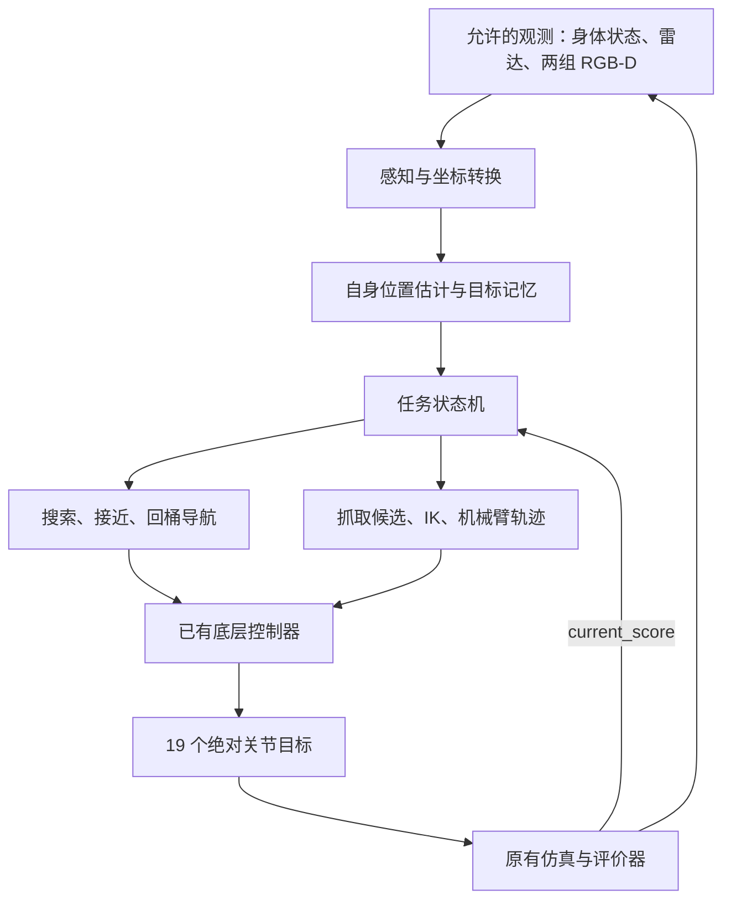

# Task B 调研与实施框架

调研日期：2026-10-21。适用对象：本目录的 B2＋Z1 教学包。

进一步的具体项目选择、源码适配核查及篮子设计见 [参考项目：BinWalker 与篮子设计](参考项目_BinWalker与篮子设计.md)。当前优先以 BinWalker 的模块化抓取与装载方法作为学习样板。

本文件是阅读源码和公开资料后的设计建议。没有运行仿真、模型推理、训练或测试，没有改变学生策略及评价环境。文中“建议”不代表已经通过实验。

## 1. 当前应完成的准备

建议顺序：固定任务规则 → 审核公开实现 → 补齐坐标与抓取知识 → 确定最小方案 → 定义模块接口 → 写实验清单 → 在远程服务器验证。

这一阶段的完成条件不是“看了多少论文”，而是可以明确回答：输入是什么、每个模块输出什么、一次抓取怎样执行、怎样发现失败、怎样确认得分，以及下一次远程实验要验证什么。

推荐第一版：已有行走模型＋RGB-D 几何感知＋视觉反馈对准＋Z1 运动学与分段轨迹＋任务状态机。先完成一个物体的完整搬运，再扩展目标种类和连续收集。是否引入学习模型，由具体瓶颈和服务器预算决定。

## 2. 以本地教学包为准的规则

| 项目 | 本包事实 | 对设计的影响 |
| --- | --- | --- |
| 机器人 | B2＋Z1，12 个腿关节＋6 个臂关节＋1 个夹爪关节 | Piper、轮足机器人的动作不能直接迁移 |
| 得分 | 每件物体第一次进入固定区域得 1 分；满分 18 | 接近、触碰和抬起都不是得分完成条件 |
| 完成 | 18 件物体同时处于目标区域 | 已得分物体再次出桶不会重复得分，仍会影响全部完成 |
| 观测 | proprio、LiDAR，以及启用后的两组 RGB-D 和内参 | 物体位置和机器人全局平移需要根据允许的观测估计 |
| 动作 | 19 个绝对关节角，单位弧度 | 不能重复使用原版动作缩放或默认偏置 |
| 移动命令 | `(vx, 0, yaw_rate)`；限幅 ±0.4 m/s、±0.6 rad/s | 通过转向和前进接近；横移不可用 |
| 命令死区 | 绝对值不超过 0.1 的速度/转向命令归零 | 近距离控制不能简单依赖无限变小的比例指令 |
| 控制周期 | 0.02 秒仿真时间，50 Hz | 底层每步调用；高层按感知更新节奏决策 |
| 相机 | 前视、腕部各一组；目标更新周期 0.1 秒 | 不能假设每个控制步都有新图像 |
| 夹爪 | 单个旋转关节，角度范围 [-1.57, 0]，0 为闭合端 | 网络给出的米制开口宽度需要按真实机构转换 |
| 时限 | 默认 1200 秒仿真时间；真实时间另设 | 分别统计仿真时间和服务器耗时 |
| 篮子 | 未安装，可自行设计 | 第一版先处理单件运输，之后再评估篮子 |

本地依据：`README.md`、`taskb_student/constants.py`、`env_cfg.py`、`low_level.py`、`scoring.py`。

本包将每件物体质量设为 0.5 kg，18 件合计 9 kg，尚未计入篮子自身。因此篮子需要额外验证重心、腿部稳定性、机械臂放入路径及卸载方式。装入篮子本身不得分。

## 3. 公开资料核查结果

### 3.1 官方默认策略是接口模板

核查了 [ATEC 官方 demo/solution.py](https://github.com/atecup/ATEC2026_Simulation_Challenge/blob/main/demo/solution.py)。当前默认 `predicts()` 构造零动作，没有完整的搜索、抓取、运输、投放控制流程。不能把官方任务代码与完整解答等同。

官方 [readme](https://github.com/atecup/ATEC2026_Simulation_Challenge) 适合了解原始比赛接口。实施时仍以本地教学包为准；本包已经更换机械臂、观测结构、动作契约和部分计分规则。

### 3.2 有价值的 Task B 公开实现：SLAM fork

仓库：[cicaburnwood-crypto/SLAM_ATEC2026_Simulation_Challenge](https://github.com/cicaburnwood-crypto/SLAM_ATEC2026_Simulation_Challenge)。本次读取的 `main` 对应提交为 `8b1cbaaf176b6d377d6d9742426425cd23fd06b6`。

已直接阅读的内容：

- [导航策略源码](https://github.com/cicaburnwood-crypto/SLAM_ATEC2026_Simulation_Challenge/blob/8b1cbaaf176b6d377d6d9742426425cd23fd06b6/demo/solution_task_b_nav_only.py)：包含扫描搜索、目标估计和大量控制状态。
- [腕部相机锁定方案](https://github.com/cicaburnwood-crypto/SLAM_ATEC2026_Simulation_Challenge/blob/8b1cbaaf176b6d377d6d9742426425cd23fd06b6/doc/task_b_ee_lock_pipeline.md)：头部相机找目标，近距离交给腕部相机，利用图像误差持续调整。
- [物体分类方案](https://github.com/cicaburnwood-crypto/SLAM_ATEC2026_Simulation_Challenge/blob/8b1cbaaf176b6d377d6d9742426425cd23fd06b6/doc/task_b_object_classifier.md)：将候选图像裁剪为 sugar、mustard、banana、unknown，提供轻量模型的设计思路。

重要限制：导航源码开头明确描述触碰流程；初始化中 `reach_only_finish=True`、`enable_bin=False`。得分增加后的处理还会标记触碰成功。这与本包删除接近/触碰得分后的任务不同。关闭一个配置项，也不等于已经证明完整抓取运输可靠。

可借鉴：相机分工、搜索覆盖、目标去重、状态切换、丢失后重新搜索、日志事件。必须重做或验证：Z1 运动学、夹爪、臂轨迹、动作尺度、停止条件、得分反馈语义、传感器接口和模型依赖。

本次没有在该项目中核实到可直接迁移到本教学包的“18 件全部真实搬运成功”结果。

### 3.3 其他检索线索的状态

检索结果中出现了 ZSN2024 的 B2wPiper Stage1 训练文档，但本次直接访问目标文件返回 404。没有将搜索缓存当成当前可下载、可复现的解答，也未依据其耗时估算本项目预算。

## 4. 论文阅读顺序及要解决的问题

每份资料至少提取：输入、输出、坐标约定、适用夹爪、权重是否可获取、环境依赖、失败案例、接入本项目需要改什么。当前只核查论文摘要、项目说明和相关接口，不声称已完成全文复现。

| 优先级 | 资料 | 主要学习目标 | 本项目的使用边界 |
| --- | --- | --- | --- |
| 高 | [Visual Servo Control, Part I，2006，作者资料页](https://faculty.cc.gatech.edu/~seth/res.php?u=vs) | 用图像或三维位置误差持续修正机器人动作 | 为近距离对准提供原理；相机移动和目标丢失仍需单独处理 |
| 高 | [Closing the Loop for Robotic Grasping / GG-CNN，RSS 2018](https://arxiv.org/abs/1804.05172)；[作者代码](https://github.com/dougsm/ggcnn) | 从深度图预测抓取位置、角度、宽度，并在执行中更新 | 先理解平面抓取与视觉闭环；不能直接假定倾斜腕部视角下的任意 6D 抓取都适用 |
| 中 | [GraspNet-1Billion，CVPR 2020](https://openaccess.thecvf.com/content_CVPR_2020/html/Fang_GraspNet-1Billion_A_Large-Scale_Benchmark_for_General_Object_Grasping_CVPR_2020_paper.html) | 点云到抓取候选，以及怎样评价抓取质量 | 是抓取子模块参考，不提供本任务的导航与运输闭环 |
| 中 | [Contact-GraspNet，ICRA 2021](https://arxiv.org/abs/2103.14127)；[作者代码](https://github.com/NVlabs/contact_graspnet) | 从场景点云提出包含位置、朝向和开口宽度的抓取候选 | 需要过滤地面和非目标区域，并结合 Z1 可达性、夹爪结构及碰撞检查 |
| 背景 | [Walk These Ways，CoRL / PMLR 2023](https://proceedings.mlr.press/v205/margolis23a.html) | 理解步态节拍、历史信息和高层速度指令的作用 | 不替换老师模型，也不假定本包开放论文的全部控制自由度 |

Contact-GraspNet 作者代码说明的测试栈是 Python 3.7、TensorFlow 2.2、CUDA 11.1，与教学服务器 Python 3.11、PyTorch 2.7 不同。若后续采用，应先设计依赖隔离和输入输出接口，避免直接改动仿真环境依赖。当前不安装、不下载权重、不启动模型。

第一版先尝试几何候选和可解释控制。确有候选质量瓶颈时，再在同一批相机数据上比较学习模型。ACT、Diffusion Policy、VLA、完整端到端强化学习等路线，待确认有适配的数据、权重和预算后再评估。

## 5. 写策略前必须理清的几何问题

1. 像素与深度怎样变成相机坐标？本包深度是光轴深度，使用提供的内参 K，过滤无效值；不能当作斜向欧氏距离。
2. 相机光学坐标与配置中的 `world` 轴约定怎样对应？不能把不同坐标习惯下的三个数字直接相加。
3. 前视相机坐标怎样变到机器人 `base`？腕部相机怎样通过当前关节角和正运动学变到 `base`？腕部外参会随机械臂运动。
4. 真正执行抓取的参考点在哪里？URDF 末端 link 原点、相机原点和两爪之间的抓取中心未必重合。
5. Z1 在当前站立姿态下能覆盖哪些地面位置？接近距离、末端朝向和预抓取姿态必须与可达区域一起设计。
6. 到达目标点的全过程会不会穿过机身、腿或地面？本包关闭内部自碰撞，不能依赖仿真阻止机械臂穿过自身。

准备产物应包括坐标变换图、关节及工具定义、可达性验证方案。当前没有运行运动学求解，不能声称任意地面目标都已确认可达。

## 6. 建议的系统 pipeline



### 感知与目标记忆

- 前视相机负责发现候选；深度帮助去除地面并估计相对位置。雷达辅助大范围几何感知，不把它当作可靠的小物体识别器。
- 腕部相机负责近距离重新定位、对准和观察抓取过程。
- 所有物体都需要收集，第一版可以优先识别可抓取候选，不必先把三类语义分类做成独立前置门槛；分类可以辅助选择不同抓取姿态。
- 记录内部跟踪 ID、位置估计、置信度、最近观测时间、失败次数。内部 ID 来自跨帧匹配，不使用评价器物体索引。

### 自身位置估计与导航

- 已知出生位置；用身体速度、姿态和控制周期累计估计位移，称为里程计。累计误差会增长，必须记录这种不确定性。
- 用当前可见目标做局部视觉反馈；回桶时利用桶的视觉/几何观测重新对准。
- 第一版采用有覆盖性的搜索路线和转向后前进的局部控制，处理命令死区和停止抖动。
- 是否引入完整 SLAM，由回桶误差和重复识别问题决定。空旷场地、重复地面纹理和动态小物体可能使现成 SLAM 难以直接使用；这仍待远程数据验证。

### 抓取、运输与投放

- 根据目标形状提出少量抓取候选，用 IK、关节限位、可达性及碰撞条件筛选。
- 执行预抓取 → 靠近 → 缓慢闭爪 → 小幅抬升 → 验证。遵守现有夹爪限速和目标超前量约束。
- 结合腕部视觉连续帧和关节状态估计是否夹持；闭爪指令或夹爪停住都不能单独证明成功。证据不足时保留“未知”状态并重新观察。
- 运输前确认物体仍被持有，并采用经过带物测试的姿态；不能把完整闭爪的空手收臂姿态直接当成万能持物姿态。
- 到桶附近重新对准，规划越过桶沿的释放路径；释放后通过观测与分数增量确认投放。

## 7. 状态机与失败恢复

主流程：

`SEARCH → APPROACH → STOP_AND_ALIGN → PREGRASP → CLOSE → LIFT_VERIFY → CARRY → BIN_ALIGN → RELEASE → PLACE_VERIFY → SEARCH`

| 状态 | 正常退出的证据 | 失败后的动作 |
| --- | --- | --- |
| SEARCH | 连续观测到有置信度的候选 | 换视角或前往尚未覆盖区域 |
| APPROACH | 进入当前机械臂可达的接管区域 | 目标丢失则停下重找；不要继续盲走 |
| STOP_AND_ALIGN | 机身停稳、目标可见、误差收敛 | 调整站位或重新观察 |
| PREGRASP | IK 与轨迹可行，关节跟踪误差可接受 | 换候选或退出当前目标 |
| CLOSE | 已执行闭合过程 | 等待后进入验证，不直接宣布抓取成功 |
| LIFT_VERIFY | 多项观测支持物体被持有 | 打开、撤回、重新定位或暂缓该目标 |
| CARRY | 到达桶附近且夹持状态仍合理 | 怀疑掉落时停止并检查、重新定位 |
| RELEASE | 已到可释放位置并执行松爪 | 轨迹不可达则重新调整站位 |
| PLACE_VERIFY | 得分增加，并完成必要的投放观察 | 重新观察桶沿、物体和夹爪，判断是否补放 |

每个状态都应有超时、有限重试次数、回退路径和失败原因。具体距离、角度、等待时长等阈值必须经数据和实验确定，当前不写成“已调好”的参数。

持物时如确需清理步态历史，使用 `reset_locomotion()`；新一局才用完整 `reset()`。前者保留机械臂与夹爪目标。

## 8. 建议的代码边界（尚未创建这些模块）

```text
demo/
  solution.py       保留原入口，协调模块和控制周期
  config.py         参数与状态超时
  perception.py     RGB-D、候选提取、跟踪
  frames.py         相机/机身/机械臂/工具坐标与正运动学
  world_model.py    里程计、置信度、目标记忆与去重
  navigation.py     搜索覆盖、目标接近、回桶
  grasp.py          抓取候选、IK、分段轨迹、夹持验证
  fsm.py            状态切换、重试、失败恢复
```

模块之间应交换带坐标系、时间和置信度的结构化结果，例如 `Detection`、`TargetEstimate`、`GraspCandidate`、`MotionCommand`、`ExecutionStatus`。不要只传三个没有坐标标签的浮点数。

保留 `taskb_student/low_level.py` 作为已有底层适配器，保持评价脚本、计分、终止与物体状态接口的原有边界。

## 9. 后续远程实验顺序

| 阶段 | 要验证什么 | 应保存什么证据 |
| --- | --- | --- |
| 0：环境与传感器 | 正确版本启动；相机、雷达和身体状态随机器人更新 | 版本记录、实际快照、日志 |
| 1：坐标与可达性 | 图像点到 base 的转换正确；臂能到预定抓取姿态 | 投影叠加图、关节误差、轨迹录像 |
| 2：只接近 | 多个位置的候选可稳定进入抓取接管区 | 接近误差、丢失次数、时间 |
| 3：只抓起 | 在正式场景中选一件目标完成抬升和持物 | 抓取尝试数、成功数、失败分类 |
| 4：单件闭环 | 抓起后运到桶内，观察到 +1 分 | 全流程录像、状态日志、原计分输出 |
| 5：连续多件 | 去重、重试、回桶和释放持续有效 | 每件耗时、掉落率、分数变化 |
| 6：泛化 | 三种物体、不同位置、不同 seed 下表现如何 | 固定评测表、失败案例和版本对应关系 |

先选一个目标，不表示删除或挪动其余物体。正式评估始终保留任务场景、原计分和异常终止条件。seed 用于重现实验，不用于在策略内生成真实物体坐标。

日志应记录：版本、seed、step、仿真时间、真实时间、状态、内部目标 ID、观测来源、位置估计及置信度、移动命令、关节跟踪误差、夹爪状态估计、分数增量和失败原因。日志不能成为额外真值输入。

主要指标：完整投放数、抓取成功率、运输保持率、投放成功率、单件耗时、异常终止率。分别记录各阶段的成功数和尝试数，避免只看最终总分。

## 10. 本机与远程服务器的分工

当前本机：阅读源码、查资料、整理坐标关系、设计接口、编写待执行实验步骤和解释代码。不运行仿真、模型、训练或数值实验。

后续远程：核对 GPU/显存、CPU/内存、驱动、环境版本、磁盘、图形/无窗口渲染、文件传输和日志导出条件；再运行仿真与实际策略。需要训练时再单独安排预算。

当前尚未确认远程服务器地址、配置、账号、可用时间和预算，因此不能对帧率、训练耗时或需要租用的机器型号作出承诺。

准备完成后的第一个实验问题应是：在现有正式环境和合法观测下，能否稳定发现一个物体、把夹爪对准它并抓起？随后立即接上单件投放闭环。
